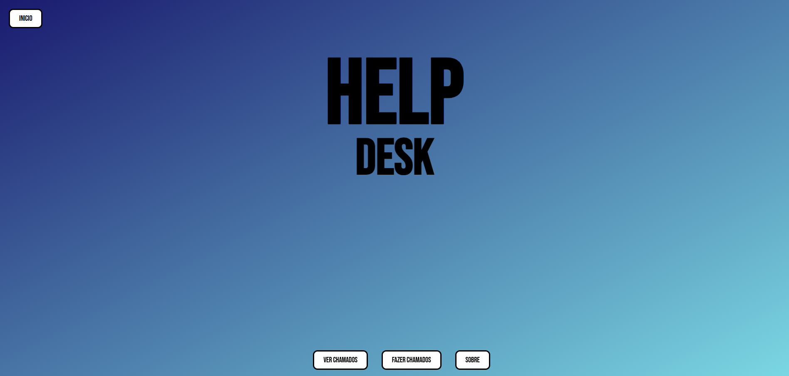
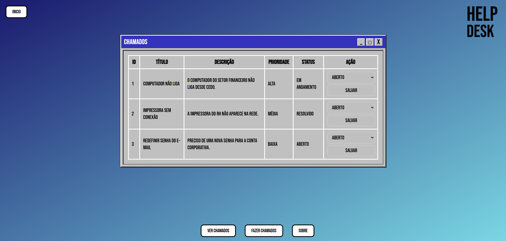
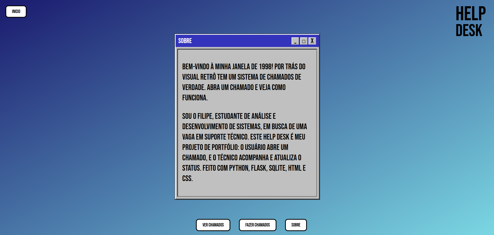

# 🖥️ Help Desk

Mini sistema de chamados (help desk) feito em **Python**, **Flask** e **SQLite**, com visual inspirado no **Windows 98**.

Projeto criado para praticar desenvolvimento web, banco de dados e orientação a objetos, simulando o fluxo de um setor de suporte técnico: abrir um chamado, acompanhar a fila e atualizar o status.

---

## ✨ Funcionalidades

- 📝 **fazer chamados** por meio de um formulário
- 📋 **Listar chamados** em uma tabela
- 🔄 **Alterar o status** de cada chamado
- 💾 **Armazenamento em banco de dados** SQLite
- 🎨 **Visual retrô** estilo Windows 98, com botões pixelados e janelas clássicas
- 📄 Páginas: **Início**, **Abrir chamado**, **ver chamados** e **Sobre mim**

## 🖼️ Telas

| Início | fazer chamados |
|--------|---------------|
|  |  |

| Ver chamados | Sobre mim |
|--------------|-----------|
|  |  |

## 🛠️ Tecnologias


## 📁 Estrutura do projeto

```
helpdesk/
├── app.py            # Rotas e lógica da aplicação (Flask)
├── classes.py        # Classe responsável pelo banco de dados (POO)
├── status.db         # Banco de dados SQLite
├── templates/        # Páginas HTML (base.html e telas)
└── static/
    └── estilo.css    # Estilo Windows 98
```

## 🧠 O que aprendi

- Criar rotas e páginas com **Flask**
- Usar **templates** com herança (`base.html`) para reaproveitar o layout
- Gravar e consultar dados com **SQLite**
- Organizar o código com **orientação a objetos**, agrupando as funções do banco em uma classe
- Estilizar com **CSS** um visual temático
- Versionar o projeto com **Git** e **GitHub**

## ▶️ Como executar

1. Clone o repositório:
```bash
git clone https://github.com/filipemosquito99-prog/HELPdesk.git
cd HELPdesk
```

2. Instale o Flask:
```bash
pip install flask
```

3. Execute a aplicação:
```bash
python app.py
```

4. Abra no navegador o endereço que o Flask mostrar no terminal (normalmente `http://127.0.0.1:5000`).

## 🚀 Próximos passos

- [ ] Filtrar chamados por status
- [ ] Adicionar prioridade aos chamados
- [ ] Tela de login para técnicos

## 👨‍💻 Autor

**Filipe Mesquita**
Estudante de Análise e Desenvolvimento de Sistemas | Fortaleza, CE

🔗 GitHub: [filipemosquito99-prog](https://github.com/filipemosquito99-prog)