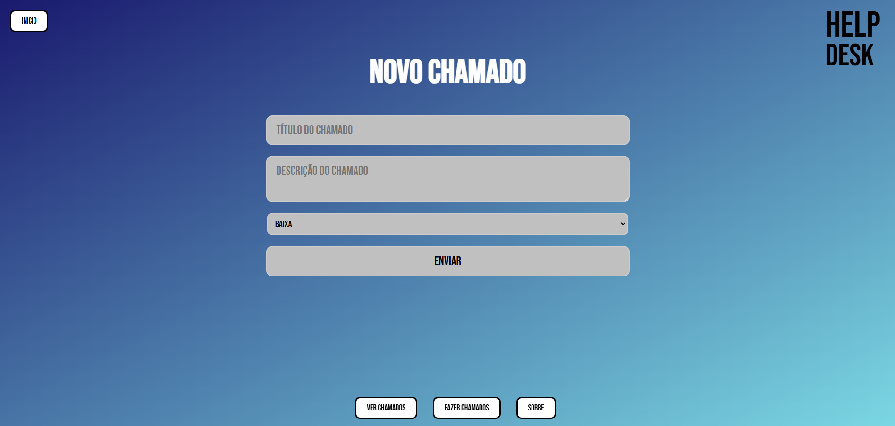

# Help Desk

Sistema de chamados de TI com visual inspirado no Windows 98, feito em Python e Flask.

O usuário abre um chamado, e o técnico acompanha a lista e atualiza o status de cada um (aberto, em andamento ou resolvido). Os chamados ficam guardados num banco de dados SQLite.

Projeto de portfólio criado por **Filipe Mesquita**, estudante de Análise e Desenvolvimento de Sistemas, em busca de uma vaga em Suporte Técnico.

## Telas

### Página inicial


### Abrir chamado


### Lista de chamados


### Sobre


## O que o sistema faz

- Abre chamados com título, descrição e prioridade (baixa, média ou alta)
- Lista todos os chamados numa tabela
- Atualiza o status de cada chamado com um clique
- Cria o banco de dados sozinho na primeira execução
- Mantém o mesmo menu e o mesmo visual em todas as páginas, usando um template base

## Tecnologias

- **Python 3** e **Flask** (rotas e servidor web)
- **SQLite** (banco de dados, pelo módulo `sqlite3` do Python)
- **HTML** com templates **Jinja2**
- **CSS** feito à mão, sem frameworks
- Fonte **Bebas Neue** (Google Fonts)

## Como rodar

Você precisa do Python 3 instalado.

```
git clone https://github.com/filipemosquito99-prog/HELPdesk.git
cd HELPdesk
python -m pip install flask
python app.py
```

Depois, abra `http://127.0.0.1:5000` no navegador.

## Rotas

| Endereço | O que faz |
|---|---|
| `/` | Página inicial |
| `/fazer_chamados` | Formulário para abrir um chamado |
| `/ver_chamados` | Tabela com todos os chamados |
| `/chamados/<id>` | Atualiza o status de um chamado (envio do formulário da tabela) |
| `/sobre` | Sobre o projeto |

## Estrutura do projeto

```
HELPdesk/
├── app.py                  # rotas e funções do banco de dados
├── static/
│   └── estilo.css          # visual da aplicação
├── templates/
│   ├── base.html           # estrutura e menu usados por todas as páginas
│   ├── inicio.html
│   ├── fazer_chamados.html
│   ├── chamados.html
│   └── sobre.html
└── prints/                 # imagens usadas neste README
```

O arquivo `status.db` (o banco de dados) é criado automaticamente ao rodar o projeto e não vai para o repositório.

## Próximos passos

- Refatorar o código para orientação a objetos, agrupando as funções do banco numa classe
- Botão para excluir chamados
- Mostrar o status atual já selecionado na caixa de escolha da tabela

## Autor

Filipe Mesquita, [github.com/filipemosquito99-prog](https://github.com/filipemosquito99-prog)
